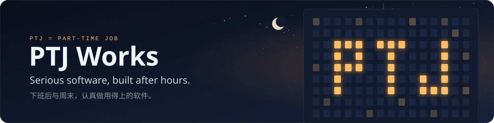
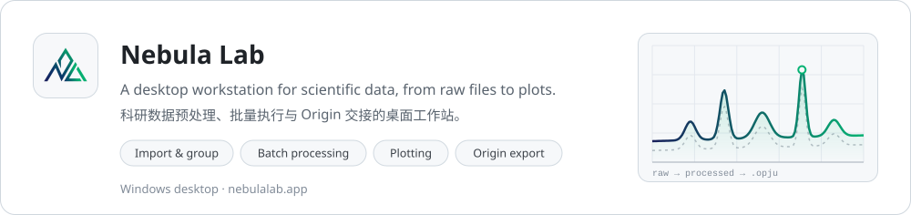
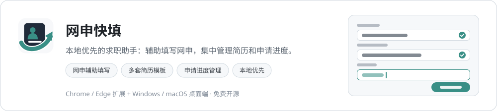

  

  PTJ started as <i>Part-Time Job</i>: software we build after work and on weekends.

 

<a href="https://nebulalab.app/">
  <picture>
    <source media="(prefers-color-scheme: dark)" srcset="./assets/card-nebula-lab-dark.svg">
    
  </picture>
</a>

  
  
  
  

 

<a href="https://github.com/ptjworks/resume-form-assistant-plugin">
  <picture>
    <source media="(prefers-color-scheme: dark)" srcset="./assets/card-wangshen-kuaitian-dark.svg">
    
  </picture>
</a>

  
  
  

 

  Questions or ideas? Open an issue in the project's repository.

